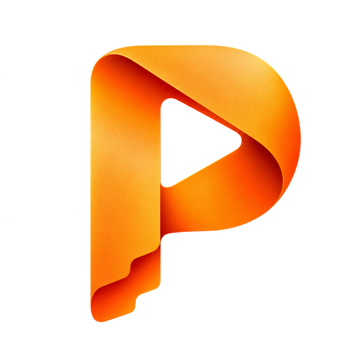

# PlayDex

A lightweight, installable web app that tracks your game sessions, playtime by game, and daily playtime goals. Everything runs locally in your browser as a single file, with optional Dropbox backup.



## Features

- **Track sessions** – start/stop with live elapsed time, pause/resume, and an optional time target (notifies when reached).
- **Session log** – review, edit, sync-flag, and delete sessions; add optional notes, filter by game and date range, and export matching sessions; overlap warnings help catch conflicting times; the running session shows in the tab title.
- **Playtime stats** – last 7 / last 30 days charts, a this-week review, and side-by-side game comparisons.
- **Daily goal & quests** – daily playtime goal, daily/weekly quests, and play-streaks with earned streak freezes.
- **Game library** – add, edit, archive, pin, and search games; see how long ago each was last played.
- **Player profile & badges** – achievements and levels, milestones, a time-of-day heatmap, and a cumulative playtime curve.
- **Backup & export** – JSON export/import and CSV export, plus optional Dropbox sync across devices with the five previous changes and rollback from Settings.
- **Installable PWA** – works offline; install it as a standalone app on desktop or mobile.
- **Themes & interfaces** – dark / light (follows your system) with accent-colour choices, and a choice of the Classic look or a Google Material 3 look.

## Getting started

PlayDex is a static, self-contained app. No build step or server is required to develop it.

### Run locally

Open `index.html` directly in a browser, or serve the folder with any static server:

```bash
# Python
python -m http.server 8080

# or Node
npx serve .
```

Then visit `http://localhost:8080`.

> Data is stored in your browser's `localStorage`. To keep it across devices, enable Dropbox sync.

### PWA install

Because it's a PWA, PlayDex needs to be served over **HTTPS** (or `localhost`) for installation and the service worker to work.

- Desktop (Chrome/Edge): open the app, then click **Install app** in the header (or use the browser's install icon in the address bar).
- Mobile (iOS): open the app in Safari → **Share** → **Add to Home Screen**.
- Mobile (Android): open the app in Chrome → **Install app** (or the browser menu → *Add to Home screen*).

## Project structure

```
PlayDex/
├── index.html              # The whole app (HTML, CSS, and JS)
├── manifest.webmanifest    # PWA manifest (name, icons, display mode)
├── sw.js                   # Service worker (offline app shell + caching)
├── icon-192.png            # Install icon (192px)
├── icon-512.png            # Install icon (512px)
├── apple-touch-icon.png    # iOS home-screen icon
└── README.md
```

## Dropbox sync

The sync features need HTTPS (or `localhost`). To connect your own Dropbox account:

1. Create a Dropbox app in the [App Console](https://www.dropbox.com/developers/apps) (permission type: *App folder*).
2. Register the exact URL of this page as a **Redirect URI** for your app.
3. Enter your app key in PlayDex → **Dropbox Sync** → connect.

Your data is sent directly from your browser to Dropbox — nothing is stored on a server. For more detail, open **Dropbox Sync** inside the app.

## License

This project is for personal/portfolio use. No warranty is provided.